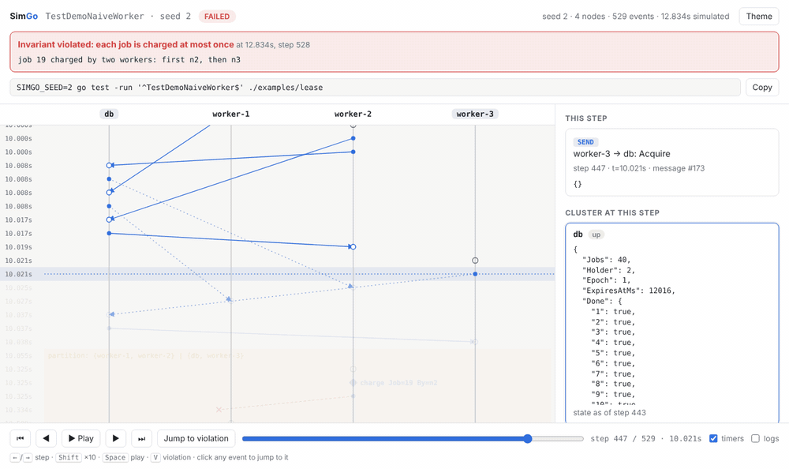
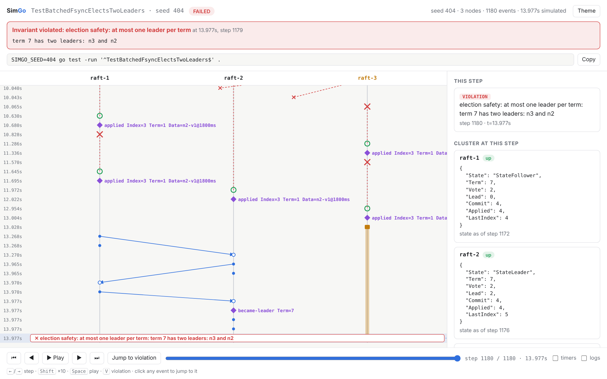
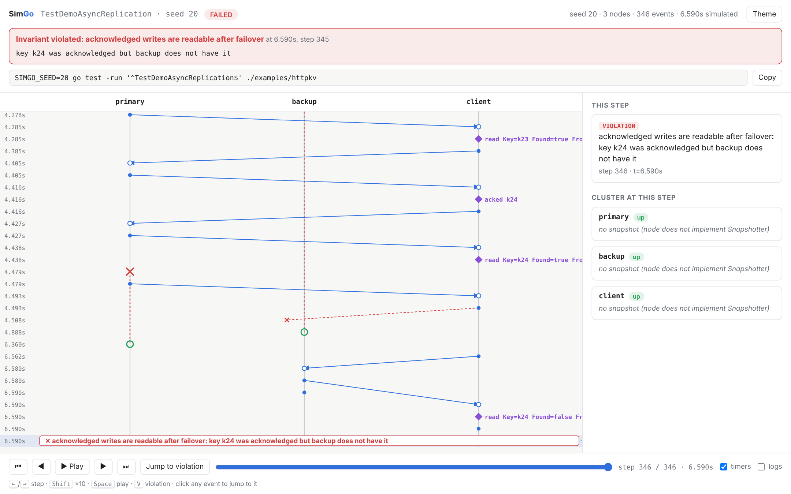

# SimGo

**Deterministic simulation testing for distributed systems in Go, with a
time-travel debugger for every bug it finds.**

SimGo runs your whole cluster inside one `go test` process. It controls the
clock, the network, the disks and every random number, then throws crashes,
partitions, process pauses, lost packets and clock skew at your code,
thousands of runs per minute. When something breaks you get:

- the **seed** that replays the failing run, and
- a **time-travel debugger**: one self-contained HTML file showing every
  node, message and fault on a timeline you can scrub back and forth, with
  each node's state at every step.



Rust has [MadSim](https://github.com/madsim-rs/madsim) and
[Turmoil](https://github.com/tokio-rs/turmoil); FoundationDB and TigerBeetle
built their own simulators. SimGo brings the technique to Go.

> **Status:** v0.1, early. The core (event-handler mode) is stable enough to
> use; goroutine mode and the hosted service are experimental. See the
> [roadmap](docs/ROADMAP.md).

## What it has found

Each example has a buggy and a fixed version. The buggy ones look reasonable
and pass ordinary tests.

| Example | The bug | What SimGo found |
|---------|---------|------------------|
| [`examples/raft`](examples/raft): the real [etcd raft](https://github.com/etcd-io/raft) library | fsync batched on a 50ms timer instead of before sending (breaks raft's storage contract) | **Two leaders in one term** and **different data committed at the same log index**, plus 376 runs where raft's own corruption check fired, in 3,000 seeds. Correct storage passes 300 seeds. |
| [`examples/httpkv`](examples/httpkv): primary/backup service on **unmodified `net/http`** | Writes acknowledged before replication | Acknowledged writes missing after failover in 4 of 40 seeds; every failure replayed byte-identically (12 of 12). Synchronous replication passes. |
| [`examples/lease`](examples/lease): lease-based payment runner | Leader keeps charging after losing its lease; lost "done" acknowledgement | Customers charged twice in 175 of 200 seeds, from **two distinct bugs** that hosted exploration reports separately. The fenced version passes 500 seeds. |
| [`examples/wal`](examples/wal): key-value server with group commit | Write acknowledged before the fsync that covers it | Acknowledged writes lost on crash in 100 of 100 seeds. Acking after fsync passes 300 seeds with the same throughput. |

<details>
<summary>Screenshots: two Raft leaders in term 7, and a lost write in net/http</summary>





</details>

## Two ways to test

### Event-handler mode: exact replay

Nodes are event handlers; SimGo owns everything nondeterministic. The same
seed always produces a byte-identical trace. This is how etcd raft runs
unmodified.

```go
type Worker struct{ /* state */ }

func (w *Worker) Start(env *sim.Env)                                     { env.SetTimer("tick", time.Second) }
func (w *Worker) Timer(env *sim.Env, name string)                        { env.Send(db, Acquire{}) }
func (w *Worker) Receive(env *sim.Env, from sim.NodeID, msg sim.Message) { /* ... env.Emit("charge", job) */ }

func TestNoDoubleCharge(t *testing.T) {
    simtest.Explore(t, sim.Config{
        Nodes:   4,
        NewNode: newNode,
        Faults: sim.FaultConfig{
            Interval: 2 * time.Second,
            Pauses: true, Crashes: true, Partitions: true, ClockSkew: true,
        },
        Invariants: []sim.Invariant{noDoubleCharge}, // checks w.Emitted("charge")
    }, simtest.Options{Seeds: 500})
}
```

```
simgo: seed 2: invariant "each job is charged at most once" violated at 12.83s: job 19 charged by two workers: first n2, then n3
    trace:  /tmp/simgo/TestNoDoubleCharge-seed-2.html
    replay: SIMGO_SEED=2 go test -run '^TestNoDoubleCharge$' ./examples/lease
```

A 20-second simulation of 5 nodes under every fault type runs in about
3 ms.

### Goroutine mode: ordinary Go code (experimental)

Write services the normal way, with goroutines, `net/http` and
`time.Sleep`. Take the listener, dialer and disk from SimGo; it runs them on
Go 1.25's `testing/synctest` fake clock over a simulated network.

```go
func primary(ctx context.Context, p *simproc.Process) error {
    ln, _ := p.Listen(80)
    srv := &http.Server{Handler: mux(p)}
    go func() { <-ctx.Done(); srv.Close() }()
    srv.Serve(ln)
    return nil
}

client := &http.Client{Transport: &http.Transport{DialContext: p.DialContext}}
```

Replays are exact unless two goroutines of the same process race at the
same virtual instant, so every failure reports its measured reproduction
rate:

```
simproc: seed 20: invariant "acknowledged writes are readable after failover" violated at 6.59s: key k24 was acknowledged but backup does not have it
    reproduced: exactly, 5 of 5 replays
```

Why it works and where it stops: [Phase 4 design](docs/design/phase4-goroutine-mode.md).

## Hosted exploration on AWS

Hundreds of seeds per commit catch common bugs; rare interleavings need
hundreds of thousands. `cloud/` splits a job into seed shards, runs them on
Fargate Spot workers that scale from zero with the queue, groups failures
into distinct bugs and keeps their traces. Terraform is in `deploy/aws/`.

```bash
cd cloud
```

```bash
SIMGO_DEMO=1 go run ./cmd/simgo-cloud local -repo .. -package ./examples/lease -test TestDemoNaiveWorker -seeds 2000 -shard-size 250 -workers 4
```

```
job 20261104-a8aab331f878ca6e (done): 8/8 shards done, 0 failed, 2000 seeds run, 1669 failing seeds

  bug 1: "each job is charged at most once" in 880 seeds (first: 2)
    job 19 charged by two workers: first n2, then n3
  bug 2: "each job is charged at most once" in 789 seeds (first: 1)
    job 28 charged twice by the same worker n3
```

See the [deployment guide](docs/deploy/aws.md).

## Getting started

Requires Go 1.25 or newer.

```bash
go get github.com/Garvit-Jethwani/simgo
```

Then read the [guide](docs/guide.md). To watch SimGo find a bug and open
its trace:

```bash
SIMGO_DEMO=1 go test -run TestDemoNaiveWorker ./examples/lease
```

## Documentation

- [Writing SimGo tests](docs/guide.md): both modes, invariants, traces, environment variables
- [Architecture](docs/ARCHITECTURE.md): components, diagrams, determinism rules
- [Design decisions](docs/adr): why a single-threaded core, event handlers, the trace format, goroutine mode
- [Phase 4 design](docs/design/phase4-goroutine-mode.md): goroutine mode, with the reproducibility experiment
- [Deploying on AWS](docs/deploy/aws.md)
- [Roadmap](docs/ROADMAP.md) and [changelog](CHANGELOG.md)

## Project layout

```
sim/          simulator core: event queue, network, disk, nemesis, trace
simtest/      go test integration: Explore, replay, JSON reports
viewer/       self-contained HTML time-travel debugger
x/simnet/     experimental: simulated TCP network on testing/synctest
x/simproc/    experimental: goroutine mode
examples/     lease, wal, raft (separate module), httpkv
cloud/        hosted exploration (separate module): core, AWS stores, CLI, Lambda
deploy/aws/   Terraform
```

The core library has no dependencies. The etcd raft example and the cloud
service are separate Go modules.

## Contributing

See [CONTRIBUTING.md](CONTRIBUTING.md).

## License

[Apache 2.0](LICENSE)
