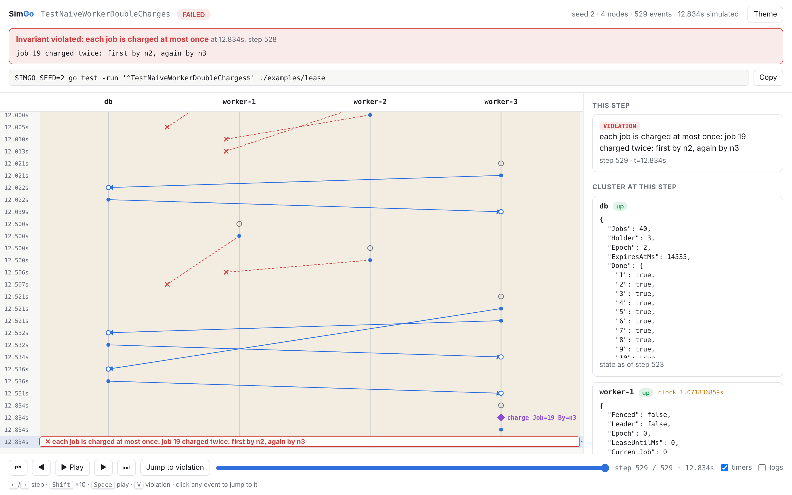

# SimGo

**Deterministic simulation testing for distributed systems in Go, with a
time-travel debugger for every bug it finds.**

SimGo runs your whole cluster inside one `go test` process. It controls the
clock, the network, the disks and every random number, then throws crashes,
partitions, process pauses, lost packets and clock skew at your code
thousands of times per minute. When something breaks, you get:

- the **seed** that reproduces exactly the same run, every time, and
- a **time-travel debugger**: one self-contained HTML file showing every
  node, message and fault on a timeline you can scrub back and forth, with
  each node's state at every step.



Rust has [MadSim](https://github.com/madsim-rs/madsim) and
[Turmoil](https://github.com/tokio-rs/turmoil). SimGo brings the same
technique to Go.

> Status: early development. See the [roadmap](docs/ROADMAP.md).

## Example: a payment runner that charges customers twice

[`examples/lease`](examples/lease) is a job runner like many real ones:
workers elect a leader with a lease row in a database, and the leader charges
pending payments one by one. The code looks correct and passes ordinary
tests.

SimGo explored 200 seeds in about 0.2 seconds and found **two different
bugs** that both charge a customer twice:

| Bug | Seeds | What happens |
|-----|-------|--------------|
| Stale leader | 100 / 200 | A worker is paused (GC pause, VM stall), partitioned, or its clock drifts. Its lease expires, another worker takes over and charges the job, then the first worker wakes up and charges it again. |
| Lost acknowledgement | 75 / 200 | A worker charges a job, but its "mark done" message is lost. The database hands out the same job again and it is charged twice. |

The fixed version sends each charge to the database with its lease epoch (a
fencing token), and the database records the charge and the "done" flag in
one step. It passes 500 seeds under the same faults.

```
$ go test -v ./examples/lease
=== RUN   TestNaiveWorkerDoubleCharges
    found the bug in 175 of 200 seeds; first: seed 1
    invariant "each job is charged at most once" violated at 22.94s: job 28 charged twice: first by n3, again by n3
    trace: /tmp/simgo/TestNaiveWorkerDoubleCharges-seed-1.html
--- PASS: TestNaiveWorkerDoubleCharges (0.17s)
=== RUN   TestFencedWorkerNeverDoubleCharges
    simgo: 500 seeds explored, no violations
--- PASS: TestFencedWorkerNeverDoubleCharges (2.00s)
```

## Writing a SimGo test

Nodes are event handlers. Everything they touch (time, network, disk,
randomness) comes from `*sim.Env`, which is what makes runs reproducible.

```go
type Worker struct{ /* state */ }

func (w *Worker) Start(env *sim.Env)                                      { env.SetTimer("tick", time.Second) }
func (w *Worker) Timer(env *sim.Env, name string)                         { env.Send(dbNode, Acquire{}) }
func (w *Worker) Receive(env *sim.Env, from sim.NodeID, msg sim.Message)  { /* ... */ }
```

Describe the cluster, the faults, and what must always be true:

```go
func TestNoDoubleCharge(t *testing.T) {
    cfg := sim.Config{
        Nodes:   4,
        NewNode: newNode,
        Network: sim.NetworkConfig{MaxLatency: 20 * time.Millisecond, DropRate: 0.01},
        Faults: sim.FaultConfig{
            Interval: 2 * time.Second,
            Pauses: true, Crashes: true, Partitions: true, ClockSkew: true,
            Protected: []sim.NodeID{0}, // the database never crashes
        },
        Invariants: []sim.Invariant{{
            Name:  "each job is charged at most once",
            Check: noDoubleCharge, // inspects w.Emitted("charge")
        }},
    }
    simtest.Explore(t, cfg, simtest.Options{Seeds: 500})
}
```

When a seed fails, the test output tells you exactly how to look at it and
replay it:

```
seed 4182: invariant "each job is charged at most once" violated at 31.2s: ...
    trace:  /tmp/simgo/TestNoDoubleCharge-seed-4182.html
    replay: SIMGO_SEED=4182 go test -run '^TestNoDoubleCharge$' ./yourpkg
```

| Variable | Effect |
|----------|--------|
| `SIMGO_SEED=n` | Run only seed `n` and always write its trace |
| `SIMGO_SEEDS=n` | Explore `n` seeds instead of the test's default |
| `SIMGO_OUT=dir` | Write traces to `dir` (default `$TMPDIR/simgo`) |

## What SimGo simulates

| Fault | Effect |
|-------|--------|
| Network | Latency and reordering, message loss, duplication |
| Partitions | Nodes split into groups; in-flight messages across the split are lost |
| Crashes | Volatile state and timers are lost, **unsynced disk writes are lost**, the node restarts later |
| Pauses | A node freezes (GC pause, VM stall) while the rest of the cluster moves on |
| Clock skew | A node's local clock jumps forward or backward |

A 20-second simulation of 5 nodes under all of these faults runs in about
3 ms, around 7,000 times faster than real time.

## How it works

Read the [architecture document](docs/ARCHITECTURE.md) and the
[design decisions](docs/adr).

## Requirements

Go 1.25 or newer.

## License

[Apache 2.0](LICENSE)
