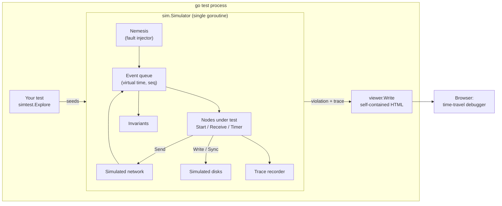
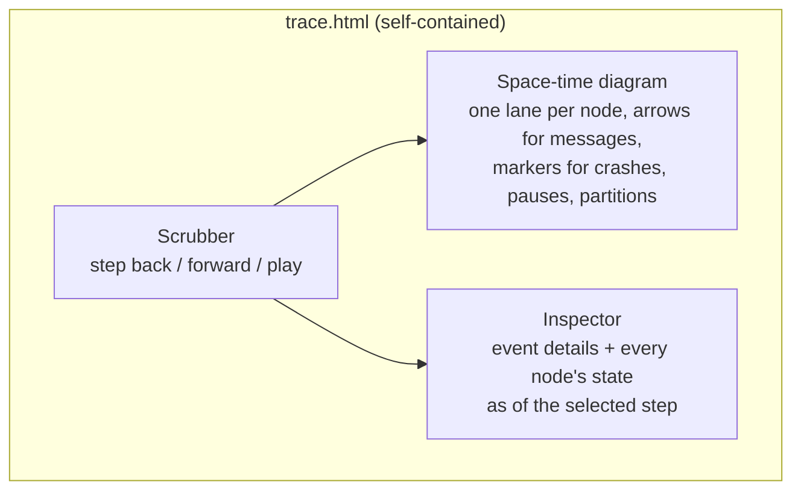
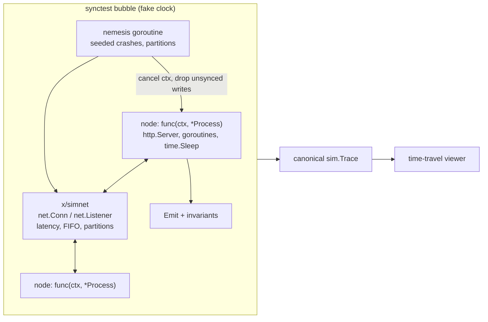
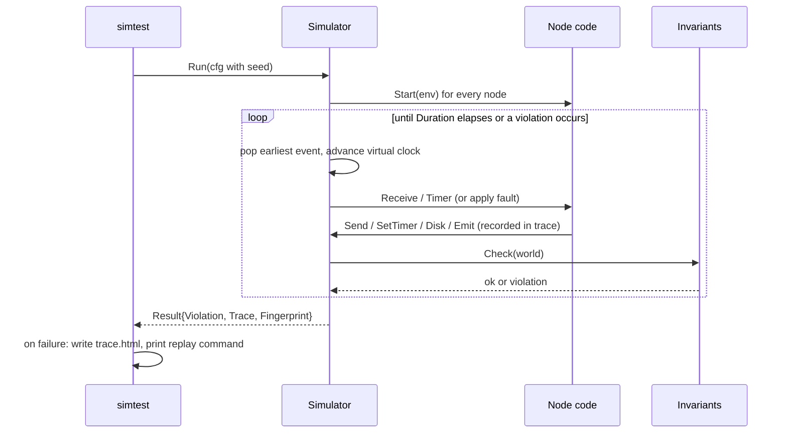
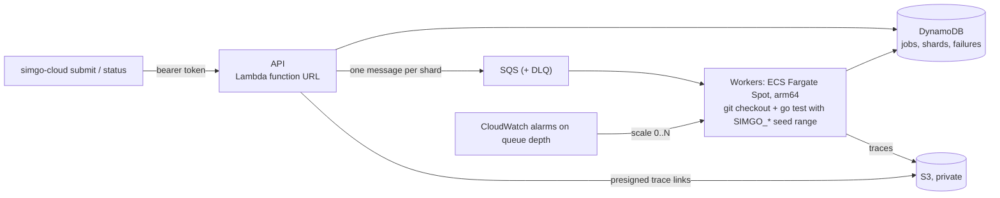

# SimGo architecture

SimGo is a deterministic simulation tester for distributed systems written in
Go, with a time-travel debugger for the failures it finds.

The idea comes from FoundationDB and TigerBeetle: run the whole cluster inside
one process, replace every source of nondeterminism (clock, network, disk,
randomness) with a simulated version controlled by a single seed, then inject
faults far faster than they would ever happen in production. When an
invariant breaks, the seed reproduces the exact same run, every time.

## Goals

1. **Reproducibility.** Same seed and same code produce a byte-identical trace.
2. **Realistic faults.** Message loss, reordering, duplication, partitions,
   crashes with lost unsynced writes, process pauses, clock skew.
3. **Speed.** Virtual time: a 60-second scenario runs in milliseconds, so a
   laptop can explore thousands of seeds per minute.
4. **Understandable failures.** Every failure comes with a visual, scrubbable
   timeline of what each node did and what it believed at each step.
5. **Plain `go test`.** No new runtime, no daemon, no code generation.

## Non-goals (for now)

- Testing arbitrary binaries or other languages (Antithesis's territory).
- Proving correctness. SimGo searches for bugs; it does not prove their absence.
- Unmodified goroutine-based code in the core. Phase 4 adds an experimental
  goroutine mode on `testing/synctest`; see the
  [Phase 4 design](design/phase4-goroutine-mode.md).

## Component overview



### Simulator (`sim`)

A single goroutine pops the earliest event from a priority queue ordered by
`(virtual time, sequence number)`, advances the clock to it, and handles it.
Sequence numbers break ties, so events at the same instant always run in the
order they were scheduled. Nothing else runs concurrently, so there are no
data races and no scheduler nondeterminism.

| Event      | What happens                                                                 |
|------------|------------------------------------------------------------------------------|
| `deliver`  | A message reaches its target. Dropped if the target is down or partitioned.  |
| `timer`    | A node timer fires. Ignored if cancelled, replaced, or the node restarted.   |
| `fault`    | The nemesis applies a fault: partition, heal, crash, restart, pause, skew.   |
| `resume`   | A paused node wakes up and processes the events queued while it was frozen.  |

After every event the simulator runs all invariants. The first failure stops
the run and is recorded as a violation. A panic inside node code is also
reported as a violation, with the panic message and the node's own stack
frames. Pointer values, goroutine IDs and frames below the simulator are
stripped, because they differ between runs and would otherwise make a
deterministic failure look nondeterministic.

### Nodes

Nodes are event handlers:

```go
type Node interface {
    Start(env *sim.Env)                                // boot and every restart
    Receive(env *sim.Env, from sim.NodeID, msg sim.Message)
    Timer(env *sim.Env, name string)
}
```

`Env` is the only way a node touches the world: `Now()`, `Send()`,
`SetTimer()`, `Rand()`, `Disk()`, `Logf()`, `Emit()`. This is the same shape as
etcd's raft library and TigerBeetle's state machines, and it is what makes
perfect determinism possible (see [ADR 0002](adr/0002-event-handler-nodes.md)).

### Simulated network

- Latency drawn uniformly from `[MinLatency, MaxLatency]` per message, which
  naturally reorders messages.
- `DropRate` and `DupRate` for loss and duplication.
- Partitions are checked at delivery time, so messages already in flight
  when a partition starts are lost, as they would be on a real network.

### Simulated disk

Writes land in a buffer that reads can see immediately, but only `Sync()`
makes them durable. A crash discards everything unsynced. This reproduces
"forgot to fsync" bugs exactly.

### Nemesis

At random intervals (mean `Faults.Interval`) the nemesis picks an enabled
fault:

| Fault      | Effect                                                                   | Undone by           |
|------------|--------------------------------------------------------------------------|---------------------|
| Partition  | Split nodes into two groups that cannot talk                             | Heal after a delay  |
| Crash      | Lose all volatile state and unsynced writes, cancel timers               | Restart after delay |
| Pause      | Freeze a node (GC pause, VM stall); its events queue up                  | Resume after delay  |
| Clock skew | Shift one node's local clock forward or backward                         | Never               |

`Faults.Protected` nodes are never crashed or paused, for nodes that model
external infrastructure such as a managed database.

### Trace and time-travel viewer

Every step is appended to a `Trace`: sends, deliveries, drops, timers, faults,
logs, emissions, and a JSON snapshot of the node's state after each event it
handled (for nodes that implement `Snapshotter`). A SHA-256 of the trace is
the run's fingerprint; running a seed twice must give the same fingerprint,
which `simtest` checks automatically.

`viewer.Write` turns a trace into a single HTML file with no external
dependencies:



### Test harness (`simtest`)

```go
func TestNoDoubleCharge(t *testing.T) {
    simtest.Explore(t, cfg, simtest.Options{Seeds: 500})
}
```

`Explore` runs many seeds in parallel (each simulation is single-threaded and
independent). For every failing seed it writes `trace.html` and prints a
one-line replay command:

```
SIMGO_SEED=4182 go test -run TestNoDoubleCharge ./examples/lease
```

## Goroutine mode (`x/simproc`)

The core requires event-handler nodes. Goroutine mode runs ordinary Go
programs instead, inside a Go 1.25 `testing/synctest` bubble:



- Time is Go's own `time` package; it advances only when every goroutine is
  blocked, so simulated time costs nothing.
- A crash cancels the node's context, crashes its network host, and drops
  unsynced disk writes. The old incarnation's `Process` stops working.
- The network log and cluster events are merged into a `sim.Trace` in
  canonical order, so the same viewer works.
- Runs are reproducible unless two goroutines of the same process race at
  the same virtual instant. `Explore` re-runs every failing seed and reports
  the reproduction rate. See the
  [Phase 4 design](design/phase4-goroutine-mode.md) for the measurements.

## Execution flow of one run



## Deployment

### Local and CI

SimGo is a library. It runs wherever `go test` runs: a laptop, or GitHub
Actions (see `.github/workflows/ci.yml`). Failing traces are uploaded as CI
artifacts.

### Hosted exploration on AWS (`cloud/`, `deploy/aws/`)

Running a few hundred seeds per commit catches common bugs. Rare
interleavings need hundreds of thousands. The hosted service splits a job
into seed shards and runs them on Fargate Spot workers that scale with the
queue, from zero.



- **Workers** are stateless: check out the commit once per job, run
  `go test` over the shard's seeds, read the `SIMGO_REPORT` JSON records,
  upload traces. An interrupted Spot task is harmless; SQS redelivers the
  shard after its visibility timeout. Code that does not build is recorded
  as a shard error, not retried.
- **De-duplication:** failures are grouped by invariant and message with
  numbers masked, so one bug found by 300 seeds shows up once.
- **The core logic** (`cloud/hosted`) has no AWS dependency; storage and
  queueing are interfaces with in-memory implementations, so the whole
  pipeline also runs on one machine (`simgo-cloud local`).

See [the deployment guide](deploy/aws.md) for setup, costs and operations.

## Determinism rules for node code

Node code must not:

- start goroutines,
- read the wall clock (`time.Now`, `time.Since`),
- use global randomness (`math/rand` top-level functions),
- iterate over maps when the order affects behaviour or messages,
- do real I/O.

Breaking these rules makes runs irreproducible. `simtest` detects it by running
each failing seed twice and comparing fingerprints. A static linter for these
rules is planned.

## Repository layout

```
sim/         simulator core: queue, network, disk, nemesis, trace
simtest/     go test integration: Explore, replay, determinism check
viewer/      self-contained HTML time-travel debugger
examples/    real bugs SimGo finds, with fixed versions
  lease/     lease-based payment runner (double charges)
  wal/       write-ahead log with group commit (lost acknowledged writes)
  raft/      the real etcd raft library (separate Go module, so the core
             library stays dependency-free)
  httpkv/    primary/backup service on unmodified net/http (goroutine mode)
x/simnet/    EXPERIMENTAL: simulated TCP network for goroutine code (Phase 4)
x/simproc/   EXPERIMENTAL: goroutine mode: processes, crashes, invariants
cloud/       hosted exploration (separate Go module): hosted/ core, awsstore/,
             cmd/simgo-cloud CLI and worker, cmd/simgo-api-lambda
deploy/aws/  Terraform for the hosted service
docs/        architecture, ADRs, design documents, roadmap
```

## Running third-party libraries

Libraries that are already event-driven state machines run unmodified. The
etcd raft example shows the two things to check:

1. **Hidden randomness.** etcd raft draws election timeouts from
   `crypto/rand`. SimGo's fingerprint check flags this immediately (two runs
   of one seed diverge). The fix is to move the decision into the simulation:
   raft's own election timer is effectively disabled and a seeded SimGo timer
   calls the public `Campaign` API.
2. **Storage contracts.** The library's durability requirements (here:
   persist HardState and entries before sending) are implemented against
   `sim.Disk`, so crashes can test them.
