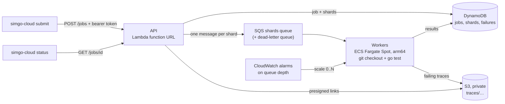

# Deploying SimGo's hosted exploration on AWS

Running a few hundred seeds per commit in CI catches common bugs. Rare
interleavings need hundreds of thousands. The hosted service splits a big
exploration into shards and runs them on cheap, interruptible capacity that
scales to zero when idle.



| Component | What it does | Cost when idle |
|-----------|--------------|----------------|
| Lambda + function URL | Submits jobs and reports status | Nothing (pay per request) |
| SQS (+ DLQ) | One message per shard; failed shards retry 3 times, then go to the DLQ | Nothing |
| ECS Fargate Spot (arm64) | Workers; scale from 0 when shards are waiting, back to 0 after 15 idle minutes | Nothing at zero tasks |
| DynamoDB (on demand) | Jobs, shard results and failures, deleted after 30 days by TTL | Storage only |
| S3 (private) | Trace HTML files, deleted after 30 days | Storage only |
| ECR | Worker image (last 10 kept) | Storage only |
| CloudWatch | Two alarms and two log groups (14-day retention) | A few cents a month |

Costs scale with worker time. Fargate Spot is much cheaper than on-demand
Fargate but can be interrupted; an interrupted shard is simply redelivered by
SQS after its visibility timeout. Use the
[AWS pricing calculator](https://calculator.aws/) with your region, worker
size (`worker_cpu`, `worker_memory`) and expected worker-hours.

## How a job runs

1. `simgo-cloud submit` sends the job (repo, commit, package, test, seed
   count, shard size) to the API.
2. The API validates it strictly (every field reaches `git`, `go test` or a
   storage key), stores it, and enqueues one SQS message per shard.
3. The backlog alarm scales the worker service up.
4. Each worker receives a shard, checks out the commit (once per job per
   worker), and runs
   `go test -count=1 -run '^TestX$' ./pkg` with `SIMGO_FIRST_SEED`,
   `SIMGO_SEEDS`, `SIMGO_REPORT` and `SIMGO_OUT` set to that shard.
5. It reads the JSON records written by `simtest.Explore` /
   `simproc.Explore`, uploads failing traces to S3, and stores each failure
   in DynamoDB, grouped by invariant and message shape.
6. `simgo-cloud status` shows progress and one entry per distinct bug, with a
   fresh presigned link to its trace.

Your test must call `simtest.Explore` (or `simproc.Explore`); the worker
controls the seed range through environment variables.

## Prerequisites

- An AWS account and credentials that can create IAM roles, ECS, Lambda,
  SQS, DynamoDB, S3, ECR and CloudWatch resources.
- Terraform 1.6 or newer, the AWS CLI v2, Docker with `buildx`, Go 1.25,
  `make` and `zip`.
- The repositories you explore must be reachable over `https://` from the
  workers. For private repositories, put a read-only token in the clone URL
  only if you accept that it is stored in DynamoDB with the job; a
  GitHub App integration is on the roadmap.

## Deploy

All commands run from `cloud/`. The default region is `ap-south-1`
(Mumbai); pass `REGION=...` to change it.

```bash
cd cloud
```

1. Build the API Lambda:

   ```bash
   make lambda
   ```

2. Create the infrastructure. The worker service starts at zero tasks, so it
   is fine that no image has been pushed yet:

   ```bash
   make deploy-infra
   ```

3. Build and push the worker image (arm64), then point the task definition
   at that tag:

   ```bash
   make push
   ```

   ```bash
   terraform -chdir=../deploy/aws apply -var image_tag=$(git rev-parse --short HEAD)
   ```

   (`make deploy` runs steps 2 and 3 together.)

4. Export the API location and token for the CLI:

   ```bash
   export SIMGO_API_URL=$(terraform -chdir=../deploy/aws output -raw api_url)
   ```

   ```bash
   export SIMGO_API_TOKEN=$(terraform -chdir=../deploy/aws output -raw api_token)
   ```

5. Submit a job. This is a confidence run: 100,000 seeds of the *fixed*
   lease worker, in 100 shards. The expected result is "no violations
   found". (The demo tests that fail by design only run with
   `SIMGO_DEMO=1`, which workers do not set; use `local` mode below to see
   failures being found and grouped.)

   ```bash
   go run ./cmd/simgo-cloud submit -repo https://github.com/Garvit-Jethwani/simgo -ref main -package ./examples/lease -test TestFencedWorkerNeverDoubleCharges -seeds 100000
   ```

6. Watch it:

   ```bash
   go run ./cmd/simgo-cloud status JOB_ID
   ```

## Try it without AWS

`local` runs the same pipeline (sharding, workers running real `go test`,
grouping, traces) on one machine with in-memory storage:

```bash
SIMGO_DEMO=1 go run ./cmd/simgo-cloud local -repo .. -package ./examples/lease -test TestDemoNaiveWorker -seeds 2000 -shard-size 250 -workers 4
```

```
job 20261104-a8aab331f878ca6e (done): 8/8 shards done, 0 failed, 2000 seeds run, 1669 failing seeds

  bug 1: "each job is charged at most once" in 880 seeds (first: 2)
    job 19 charged by two workers: first n2, then n3
    trace: file:///.../traces/20261104-a8aab331f878ca6e/seed-2.html

  bug 2: "each job is charged at most once" in 789 seeds (first: 1)
    job 28 charged twice by the same worker n3
    trace: file:///.../traces/20261104-a8aab331f878ca6e/seed-1.html
```

The worker image can run local mode too, which is a quick way to check an
image before pushing it:

```bash
docker run --rm -e SIMGO_DEMO=1 -v "$PWD/..:/repo:ro" simgo-worker:$(git rev-parse --short HEAD) local -repo /repo -package ./examples/lease -test TestDemoNaiveWorker -seeds 400
```

## Operations

- **Logs:** workers log JSON to `/simgo/worker`; the API logs to
  `/aws/lambda/simgo-api`.
- **Stuck shards:** a shard that fails three times (for example, a worker
  repeatedly running out of memory) lands in the dead-letter queue
  (`terraform output dead_letter_queue_url`). Shards whose code does not
  build are recorded as shard errors and are not retried.
- **Scaling:** `max_workers` caps concurrency (default 20). Each worker runs
  seeds in parallel across its vCPUs.
- **Trace links** are presigned and short-lived: they are signed with the
  API's temporary role credentials, so they stop working after a few hours.
  Run `status` again for fresh links.
- **Token rotation:** `terraform apply -replace=random_password.api_token`.

## Security notes

- The API is a public Lambda function URL; every endpoint except `/healthz`
  requires the bearer token, compared in constant time.
- The bucket blocks all public access and uses server-side encryption;
  traces are only reachable through presigned links.
- Workers have no inbound access (egress-only security group) and an IAM role
  limited to the one queue, table and bucket prefix.
- Workers run the code you submit. Only submit repositories you trust, and
  treat the worker role's permissions as available to that code.
- The API token is stored in the Lambda's environment (encrypted at rest).
  Moving it to Secrets Manager is a small change if your policies require it.

## Tear down

```bash
terraform -chdir=../deploy/aws destroy
```

The bucket and ECR repository are created with `force_destroy`, so traces
and images are deleted with them.
